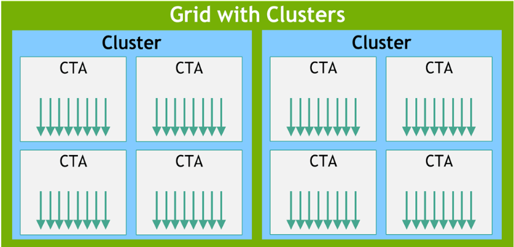
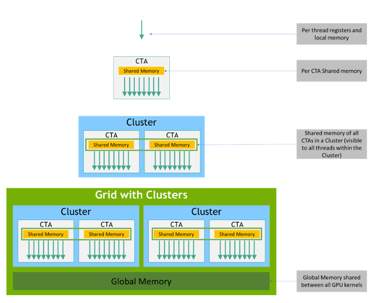
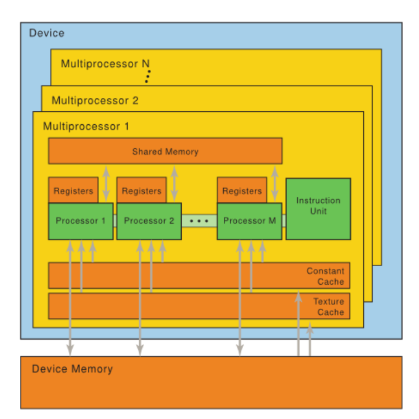
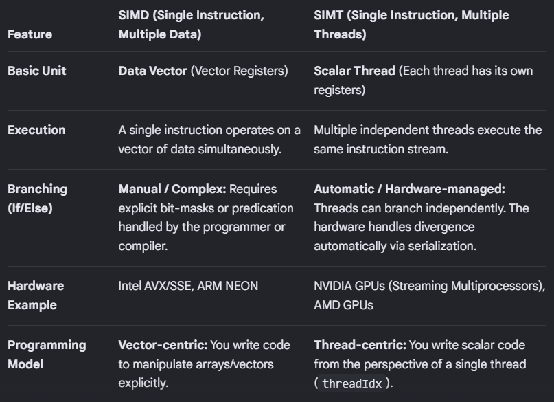
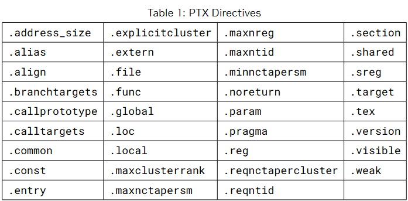
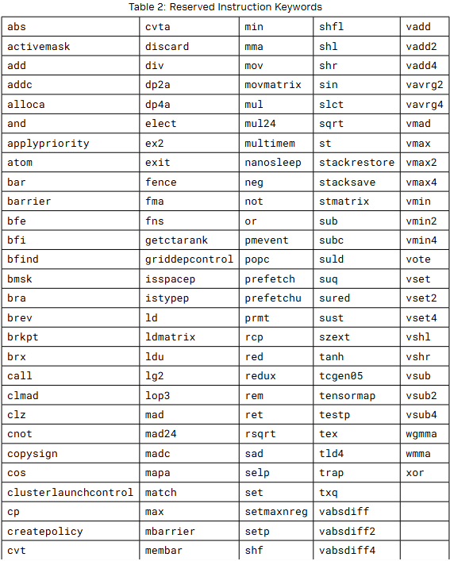
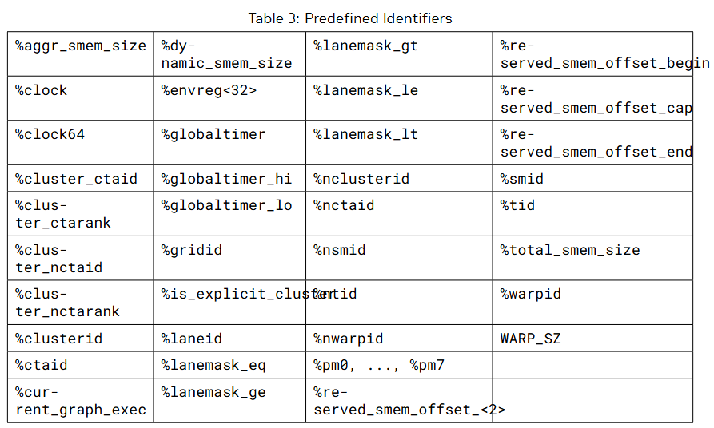
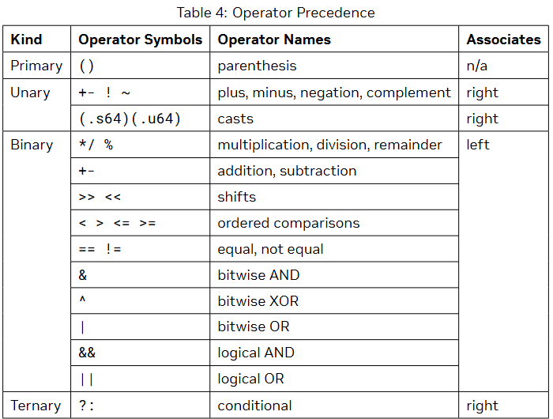
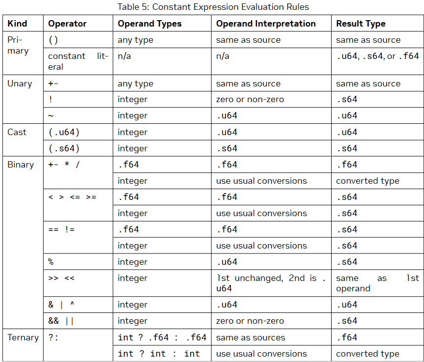

# Introduction 
## Scalable data parallel computing using GPU's
Mordern GPU's are made with multiple parallel operations performing threads.
PTX is defined as a virtual machine and a ISA for genral purpose parallel thread execution. 


## Goal of PTX
- Provide Stable ISA that provide multiple GPU genrations. 
- provide machine independent ISA for the C/C++ to target
- Facilitate hand-coding of libraries, performance kernels, and architecture tests.
- Provide a scalable programming model that spans GPU sizes from a single unit to many parallel
units.

# Programing Model
## A Highly Multithread Co-Processor
It act as a coprocessot to the host(CPU), as CPU can schedule its tasks to the GPU that required parallel execution of the thread, meanwhile ost is free to do other processes. 

## Thread Hirarchy
The batch of threads that execute a kernel is organized as grid. The grid consist either coopretive thread or cluster of coopretive thread. 

## Cooperative thread array
CTA is used for the parallel execution of the threads, the threads can comunicate with each other. to cordinate the communication we use synchronization. each thread has a unique id which is a collection of three parameter tid.x, tid.y, tid.z within a 1D, 2D, 3D CTA. Threads in the CTA execute in SIMT(Single Insturuction Multiple Thread) in groups called warps. A warp has 32 thread. PTC includes a run-time immediate constant, WARP_SZ, Which may be used in any opreand where a immediate operand is allowed.

## Cluster(Blocks) of cooperative Thread Array
Cluster is a group od CTA that can run together in parallel and can communicate with each other via shared memory. Cluster wise barrier can be used to synchronize all the thread within the cluster. each cluster in CTAs can has 1d, 2d, 3d shape specified by the parameter cluster_nctaid, each CTA in th cluster have a unique CTA  identifier that is cluster_ctarank across all dimension. and each CTA in a cluster has a unique CTA identifier that is cluster_ctaid. Threads may read and use these values through predefined, read-only special registers <b>%cluster_ctaid, %cluster_nctaid, %cluster_ctarank, %cluster_nctarank</b>. This can hold max 1024 threads.

## Grid of Clusters
Grid is a combination of cluster of CTAs, these are made so that multiple cluster of CTA can be fired for a single kernel but this comes at a cost that you cant communicate and synchronize threads in diffrent clusters. Each cluster has a unique identifier in a grid that is clusterid, Each grid of clusters has a 1D, 2D , or 3D shape specified by the parameter nclusterid, Each grid also has a unique temporal grid identifier (gridid). Threads may read and use these values through predefined, read-only special registers <b>%tid, %ntid, %clusterid, %nclusterid, and %gridid</b>

Each CTA has a unique identifier (ctaid) within a grid. Each grid of CTAs has 1D, 2D, or 3D shape specified by the parameter nctaid. Thread may use and read these values through predefined, read only special registers <b>%ctaid and %nct</b>.

## Memory Hierarchy



# PTX Machine Model

## A set of WIMT Multiprocessors:
NVIDIA GPU architecture is built around a scalable array of multithreaded Streaming Multiprocessors (SMs). When a host program invokes a kernel grid, the blocks of the grid are enumerated and distributed to multiprocessors with available execution capacity. The threads of a thread block execute concurrently on one multiprocessor. 

**NOTE**
```A GPU has only fixed number of SM's
Each SM has a fixed number of cores
Each Core have a few resident Threads

A block is given to SM for execution

ex: of H100
there are 144 SM's

each SM have 128 CUDA core, 64 FP64 cores, 4 Int32 cores, 4tensor core

A single SM of H100 can have 2048 core max

if block of 256 is used then 8 block can work on a single SM.

warp has max 32 thread, combine to make cluster of CTA's(blocks) that has max 1024 thread combine to make Grid
```



A SM consists of multiple Scalar Processor (SP) cores, a multithreaded instruction unit, and on-chip shared memory. 

To manage hundreds of threads running several different programs, the multiprocessor employs an architecture we call SIMT (single-instruction, multiple-thread). 

SIMT select a warp that is ready to execute, the warp execute one common execution at a time so full efficiency is realized when all thread of a warp agree on there execution path, otherwise if they diverge with a data driven condition branch then warp serially execute all and disabling thread that are not on the path then after execution is done then they converge back to the same execution path.



## Independent Thread Scheduling
Starting from the Volta architechture threads now contain independent program counter and call stack. and a schedule optimizer determine how to group active threads.

## On-chip Shared Memory(as in above image)
- One set of local 32-bit registers per processor.
- A parallel data cache or shared memory that is shared by all scalar processor cores and is where the shared memory space resides.(actual shared memory)
- A read-only constant cache that is shared by all scalar processor cores and speeds up reads from the constant memory space, which is a read-only region of device memory.
- A read-only texture cache that is shared by all scalar processor cores and speeds up reads from the texture memory space, which is a read-only region of device memory; each multiprocessor accesses the texture cache via a texture unit that implements the various addressing modes and data filtering.

# Syntax
PTX programs are a collection of text source modules(files). It has a assembly like syntax. Pseudo-operation specify symbol and addressing management. ptax compiler optimizes and assemble PTX source modules to produce corresponding binary object files.

## Source Format
Lines are seprated by the new line chatachter \n. 
all whitespace charachter are equivalent and ignored except for it use in seprating tokens in the language. 
Lines beigning with # are preproccessing directives.
PTX is case sensitive and uses lowercase for keywords.

## Coments
Comments in PTX follow C/C++ format. and are treated as whitespaces.

## Statements
PTX statement are either a directive or an instruction. begin with an optional lable and end with a semicolon.
EX.
```
.reg .b32 r1, r2;
.global .f32 array[N];
```

### Directive Statements
Directive keyword begin with a dot. 


### Instruction statement
These are formed from a instruction opcode followed by a comma-seprated list of zero or more operands, and terminated by a semicolon. Operands can be register variable, constant expression, adress expression, or lable names. Instruction have an optional guard predicate which controls condition execution.

A predicate is a register that hold true or false.
.reg .pred p; --> creates a predicate register p.

setp.lt.s32 p, %r1, %r2; --> this set the p true if the r1< r2 otherwise false

@p add.s32 %r3, %r1, %r2; --> this runs the add operation based on if the value of p is true.



## Identifier
User-defined identifiers follow extended C++ rules they either start with a letter followed by zero or more letter, digits, underscore or dollar charachter.
```
followsym: [a-zA-Z0-9_$]
identifier: [a-zA-Z]{followsym}* | {[_$%]{followsym}+
```

There are some predefine identifiers.


## Constants
PTX supports integer and floating-point constants and constant expressions. These constants maybe used in data initialization and as operands to instructions.

### Integer Constants
Integer constants are 64-bits in size and are either signed or unsigned, i.e., every integer constant has type .s64 or .u64.
Integer literals may be written in decimal, hexadecimal, octal, or binary notation. The syntax follows that of C.
```
hexadecimal literal: 0[xX]{hexdigit}+U?
octal literal: 0{octal digit}+U?
binary literal: 0[bB]{bit}+U?
decimal literal {nonzero-digit}{digit}*U?
```

### Floating-Point Constants
These are 64bit double precision value. The only 32-bit hex notation for single precision.
```
0[fF]{hexdigit}{8} ∕∕ single-precision floating point
0[dD]{hexdigit}{16} ∕∕ double-precision floating point
```

### Predicate constants
In PTX, integer constants may be used as predicates. For predicate-type data initializers and instruction operands, integer constants are interpreted as in C, i.e., zero values are False and non-zero values
are True.

### Constant expression
Constant expression are formed using operators as in C.

Constant expressions are formed from constant literals, unary plus and minus, basic arithmetic operators (addition, subtraction, multiplication, division), comparison operators, the conditional ternary
operator ( ?: ), and parentheses. Integer constant expressions also allow unary logical negation (!), bitwise complement (~), remainder (%), shift operators (<< and >>), bit-type operators (&, |, and ^), and logical operators (&&, ||)

Constant operation does not support cast between integer and floating point.



### Integer Constant Expression Evaluation
- Litrals are always signed unless explicit unsigned
- Unary plus and minus preserve the type of the input operand
- Unary logical negation (!) produces a signed result with value 0 or 1.
- Unary bitwise complement (~) interprets the source operand as unsigned and produces an un-
signed result.
- Some binary operation require need normalization of source operands. This means converting both to unsigned type.
- Addition, Subraction, Multiplication, and Division gice output same as the input.
- Remainder (%) interprets the operands as unsigned
- Left and right shift interpret the second operand as unsigned and produce a result with the same type as the first operand
- AND (&), OR (|), and XOR (^) perform the usual arithmetic conversions and produce a result with the same type as the converted operands.
- AND_OP (&&), OR_OP (||), Equal (==), and Not_Equal (!=) produce a signed result. The result value is 0 or 1.
- Ordered comparisons (<, <=, >, >=) perform the usual arithmetic conversions on source operands and produce a signed result. The result value is 0 or 1
- For the conditional operator ( ? : ) , the first operand must be an integer, and the second and third operands are either both integers or both floating-point.



```
nvcc -ptx predicate.cu -o predicate.ptx

to save the ptx file 

then notepad predicate.ptx to see the file
```
Genrated PTX:
```
//
// Generated by NVIDIA NVVM Compiler
//
// Compiler Build ID: CL-39125733
// Cuda compilation tools, release 13.5, V13.5.37
// Based on NVVM 7.0.1
//

.version 9.5
.target sm_75
.address_size 64

	// .globl	_Z15predicateKernelPi

.visible .entry _Z15predicateKernelPi(
	.param .u64 _Z15predicateKernelPi_param_0
)
{
	.reg .pred 	%p<2>;
	.reg .b32 	%r<3>;
	.reg .b64 	%rd<5>;


	ld.param.u64 	%rd1, [_Z15predicateKernelPi_param_0];
	cvta.to.global.u64 	%rd2, %rd1;
	mov.u32 	%r1, %tid.x;
	setp.lt.s32 	%p1, %r1, 5;
	mul.wide.s32 	%rd3, %r1, 4;
	add.s64 	%rd4, %rd2, %rd3;
	selp.b32 	%r2, 100, 200, %p1;
	st.global.u32 	[%rd4], %r2;
	ret;

}
```

```
Explanation:

.version 9.5: PTX language version.
.target sm_75: Target GPU architecture is compute capability 7.5.
.address_size 64: Uses 64-bit addresses.

Declaration	Meaning
.pred	Predicate register
.b32	32-bit register
.b64	64-bit register

%p<2> make %p0 %p1
%r<3> make %r0 %r1 %r2
%rd<5> make %rd0 %rd1 %rd2 %rd3 %rd4

ld.param.u64 	%rd1, [_Z15predicateKernelPi_param_0]; --> loads the kernel parameter into rd1

cvta.to.global.u64 %rd2, %rd1; --> convert the address into global memory address

mov.u32 %r1, %tid.x; --> %tid.x is a predefined special register containing the thread's X-coordinate within its block. The instruction copies that value into %r1. for all the threads

setp.lt.s32 %p1, %r1, 5; --> set predicate(setp) p1 to 1 if r1 is less than(lt) 5 otherwise 0, (signed32)

selp.b32 %r2, 100, 200, %p1; --> select based on predicate(selp) (p1) if 1 set r2 100 otherwise 200 

mul.wide.s32 %rd3, %r1, 4; --> Each integer occupies 4 bytes. thread0 offset 0, thread 1 offset 4, thread 2 offset 8 so on.

add.s64 %rd4, %rd2, %rd3; --> calculate the final memory address

st.global.u32 [%rd4], %r2; --> store the final value in global memory, output[r4] = r2

ret; --> ends the kernel
```

# State Spaces, Types and Variable
